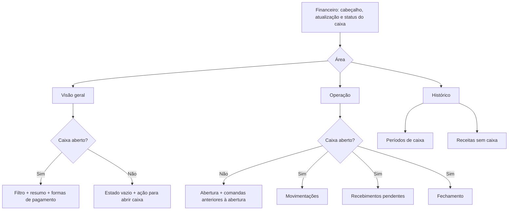

# Financeiro Tavvi — especificação de redesign

**Status:** especificação para revisão, baseada no protótipo aprovado para publicação.  
**Data:** 28/10/2026  
**Referência visual:** [Protótipo Tavvi · Financeiro](https://tavvi-financeiro-visualizacao.nimblemole5.chatgpt.site) (privado)  
**Arquivo local do protótipo:** `prototype-financeiro/index.html`

## Intenção

Reorganizar a página Financeiro para que cada responsabilidade tenha uma área própria e o conteúdo apareça sob demanda. A página deve responder rapidamente a três perguntas: qual é a situação do caixa atual, o que precisa ser feito na operação e como conferir períodos anteriores.

O redesign reutiliza os dados, ações e regras financeiras já existentes. O trabalho é de apresentação, hierarquia e navegação; não cria um novo livro-caixa, não modifica cálculos nem muda o fluxo operacional da página Caixa.

## Objetivos

- Reduzir a rolagem e a sensação de conteúdo amontoado, colocando panorama, operação e histórico em abas de primeiro nível.
- Manter o estado do caixa visível enquanto a pessoa alterna entre as áreas.
- Dar prioridade visual ao valor esperado na gaveta, sem misturá-lo com vendas, gorjetas, recebimentos e estornos.
- Separar registros ligados a períodos de caixa dos registros históricos feitos sem um período aberto.
- Conservar as ações, filtros, estados de carregamento, permissões, mensagens e trilhas de auditoria atuais.
- Fazer a hierarquia funcionar no desktop, tablet e celular, seguindo a identidade visual atual do Tavvi e do protótipo.

## Fora de escopo

- Despesas, taxas, impostos, estoque, consumo interno, conciliação externa, exportação ou novos relatórios.
- Alterar regras de abertura, recebimento, sangria, suprimento, fechamento ou exceção.
- Alterar banco de dados, RPCs, Server Actions, contratos de domínio, permissões ou cálculos do Financeiro, exceto a remoção da denominação física de R$ 0,01 da contagem, solicitada depois da aprovação. Valores financeiros continuam mantendo precisão de centavos.
- Recriar a navegação global do painel dentro da página. O shell existente continua responsável por sidebar, cabeçalho mobile e navegação do restaurante.
- Criar filtro de datas para a lista de períodos de caixa. O botão de filtro visto nessa área do protótipo é ilustrativo e não corresponde a uma capacidade atual.

## Base atual e limites que precisam ser preservados

- A rota `apps/web/src/app/admin/workspace/restaurants/[id]/financeiro/page.tsx` permite acesso a `admin` e `cashier` e carrega o panorama e o relatório legado.
- `FinanceScreen` atualiza dados em tempo real e mostra erros de carga, sem botão manual de atualização nem indicador textual de conexão. O histórico carrega primeiro 30 períodos e oferece paginação.
- `CashDayOpening` oferece entrada do total inicial ou contagem de notas e moedas; a contagem física não inclui a denominação de R$ 0,01, embora os valores financeiros mantenham precisão de centavos.
- `CashDayMovements` registra suprimento ou sangria com valor e motivo; suprimentos e sangrias alteram dinheiro esperado, mas não são receita ou despesa operacional.
- `CashDayClosing` confere dinheiro contado contra o esperado. Diferença exige motivo. Comandas em andamento bloqueiam fechamento normal; somente `admin` pode autorizar fechamento excepcional, registrar justificativa e confirmar o transporte dos saldos pendentes.
- `PendingReceivables` abre a comanda correspondente em Caixa. O saldo transportado continua ligado à comanda original; cada parcela recebida passa a pertencer ao período em que entrar.
- `CashDayHistory` expande os detalhes de um período e mantém motivos de diferença/exceção, formas de pagamento, movimentações, contas transportadas e recebíveis pendentes.
- `LegacyFinanceReport` usa seu próprio filtro de datas e informa receitas sem período aberto ou recebimentos legados sem vínculo. Esses dados não têm contagem física, suprimento, sangria ou fechamento reconstruídos.
- O contrato atual expõe `totals.expectedCashCents` como valor autoritativo. Não expõe os componentes numéricos completos do cálculo para montar o detalhamento estático que aparece no protótipo. A interface não deve inventar nem recalcular esse detalhamento no cliente.
- No panorama de um caixa ativo, o filtro de datas afeta vendas de consumo, gorjetas, recebimentos, estornos e formas de pagamento. Dinheiro esperado é o saldo corrente da gaveta no período inteiro e não deve variar com esse filtro.

## Mapa da página

## Exibições e comportamento

### 1. Estrutura persistente

1. **Cabeçalho existente:** nome do restaurante, título “Financeiro”, descrição e botão “Atualizar”. O indicador de conexão em tempo real e as mensagens de atualização permanecem próximos do cabeçalho, com prioridade visual secundária.
2. **Status do caixa:** faixa compacta e persistente logo abaixo do cabeçalho, antes das abas. Mostra “Caixa aberto” ou “Nenhum caixa aberto”, ícone contextual, início do período e fundo inicial quando ativo. A cor reforça o estado, mas o texto sempre comunica o significado.
3. **Abas principais:** “Visão geral”, “Operação” e “Histórico”, com ícones lineares consistentes com `react-icons/lu`. Só o painel selecionado ocupa o fluxo visual.
4. O banner atual “Escopo atual” sai do fluxo principal; a descrição do cabeçalho já explica o que a área acompanha. Não substituir por outra caixa informativa longa.

O shell do painel e o `MobileNavBar` existentes são mantidos. Não adicionar sidebar, rodapé de navegação ou controles globais duplicados que existam apenas no protótipo.

### 2. Visão geral

#### Sem caixa aberto

- Mostrar um estado vazio intencional, sem métricas zeradas que pareçam um relatório válido.
- Mensagem: o resumo do período começa após a abertura do caixa; botão primário “Ir para abertura do caixa” seleciona a aba Operação.
- Se houver um período encerrado no histórico com valor contado, mostrar uma linha discreta com a data e o dinheiro contado. Omitir essa linha quando não houver dado real.
- O estado vazio não cria caixa, não altera filtros e não apresenta valores fictícios.

#### Com caixa aberto

- Mostrar o `FinanceDateRangeFilter` existente com seu calendário desktop, campos mobile, validação, timezone do restaurante, ação de aplicar e feedback de carregamento.
- Usar um bloco de resumo de destaque com **Dinheiro esperado** (`totals.expectedCashCents`) como valor principal. Explicar que representa o saldo físico esperado do período inteiro, mesmo quando outro intervalo de datas estiver selecionado.
- Mostrar como dados de apoio as vendas de consumo, gorjetas brutas, total recebido e total estornado, com ícones semânticos e valores alinhados. Estorno tem tratamento visual de atenção, sem ser comunicado somente por cor.
- Abaixo, apresentar “Formas de pagamento” em linhas organizadas por meio, mantendo recebidos e estornados em colunas no desktop e em pares rotulados no mobile.
- Preservar o aviso de que vendas e gorjetas são brutas e que os estornos ficam separados, sem rateio entre consumo e gorjeta.
- Se não houver método ou recebimento no intervalo, usar o estado vazio inline atual. Não esconder dados já retornados.

### 3. Operação

#### Sem caixa aberto

- A primeira exibição é a abertura, com o título “Abrir caixa do restaurante” e texto curto sobre o fundo inicial.
- Manter os dois modos atuais: informar o total ou contar notas e moedas. Exibir o total calculado antes da confirmação.
- Manter ação “Abrir caixa”, estado ocupado, erro inline e repetição segura quando a resposta da operação ficar incerta.
- Se existirem comandas em andamento antes da abertura, mostrar um aviso destacado abaixo ou ao lado do formulário, com quantidade, mesa e saldo pendente. Explicar que essas comandas continuam ligadas ao Caixa e precisam ser finalizadas antes do fechamento normal.
- Não adicionar um atalho novo para abrir comanda a partir desse aviso enquanto a tela Caixa não oferecer essa navegação de forma existente e confirmada. A navegação já disponível em recebíveis permanece preservada.

#### Com caixa aberto

Exibir a chamada “Operação do caixa” e três subtabs, cada uma representando uma responsabilidade. “Movimentações” é a seleção inicial. O conteúdo das subtabs mantém estado ao alternar entre elas.

**Movimentações**

- Em desktop, formulário e histórico de suprimentos/sangrias ficam na coluna principal; o dinheiro esperado fica em um cartão lateral. Em tablet/mobile, os blocos empilham.
- Formulário com tipo, valor e motivo. O motivo continua obrigatório e deve ter pelo menos 3 caracteres úteis; o valor deve ser positivo e respeitar o limite do contrato atual.
- Lista os movimentos pelo mais recente, com tipo, valor assinado, motivo, horário no fuso do restaurante e operador, como já fornecido.
- O cartão “Dinheiro esperado” usa exclusivamente `totals.expectedCashCents` e texto explicativo. Não exibir um detalhamento numérico de fundo/recebimentos/estornos/sangrias enquanto esses componentes não forem fornecidos pelo servidor como dados confiáveis.
- Estados vazios, erros e bloqueio/repetição da mutation seguem `useFinanceMutation`.

**Recebimentos pendentes**

- Usar o componente atual `PendingReceivables`, com número de contas no badge da subtab quando maior que zero.
- Cada linha preserva mesa, data original, indicação de gorjeta quando aplicável, saldo aberto e ação “Receber no Caixa” com destino à comanda original.
- Estado vazio explica que saldos transportados ficam disponíveis ali; não os soma ao dinheiro físico esperado.

**Fechamento**

- Manter valor esperado, opção de informar total ou contar notas/moedas, valor contado e diferença com sinal e mensagem textual.
- Se a diferença não for zero, exigir motivo. Não usar o campo “Observação (opcional)” fictício do protótipo: o contrato atual só prevê motivos de diferença e de exceção.
- Se houver comandas bloqueadoras, explicar a causa e listar seus saldos. `cashier` pode realizar fechamento normal quando permitido, mas não vê autorização de exceção; `admin` pode ativar fechamento excepcional, preencher justificativa e confirmar explicitamente o transporte dos saldos.
- Botão primário comunica a ação exata: fechamento normal ou excepcional. Mostrar ocupado, falha e repetição segura sem permitir trocar de contexto durante operação pendente.

### 4. Histórico

Organizar o conteúdo em subtabs “Períodos de caixa” e “Receitas sem caixa”.

**Períodos de caixa**

- Reutilizar `CashDayHistory`: período/data, horários de abertura e fechamento, status, fundo inicial e valor contado ou esperado.
- Manter expansão por período, carregamento sob demanda dos detalhes, estados de carregamento/erro e botão “Carregar períodos anteriores”.
- Preservar timezone do restaurante e todos os campos de auditoria já apresentados pelo detalhe.
- Não introduzir filtro para esta lista. O protótipo mostra um botão ilustrativo, sem integração ou suporte correspondente no contrato atual.

**Receitas sem caixa**

- Reutilizar `LegacyFinanceReport`, incluindo seu filtro de datas independente, indicadores, meios de pagamento e estados de erro/vazio.
- Explicar com texto breve que são registros classificados pelo horário original, sem reconstrução de gaveta ou fechamento físico.
- Manter cada filtro isolado: o filtro do panorama não altera o relatório legado, e o filtro legado não altera o caixa ativo.

### 5. Seleção, atualização e persistência de contexto

- Primeira entrada: selecionar “Visão geral” quando existir `activeDay`; sem período ativo, selecionar “Operação”.
- Ao mudar de aba, manter montados os painéis que contêm formulário, filtro ou detalhe expansível, para que a seleção e o progresso não desapareçam.
- Uma abertura bem-sucedida mantém a pessoa em Operação e apresenta Movimentações como próxima tarefa. Um fechamento bem-sucedido mantém Operação e mostra a tela para abrir o próximo período. Atualizações em tempo real atualizam dados sem forçar mudança de aba.
- O badge da aba Operação pode sinalizar comandas em andamento antes da abertura, somente quando o caixa estiver fechado. O badge de Recebimentos pendentes usa `pendingReceivables.length` e aparece somente quando houver itens.
- Não exibir botão manual de atualização nem indicador textual de conexão. Manter atualizações em tempo real silenciosas, filtros e seus estados de carregamento/erro. A organização visual não deve alterar idempotência nem o identificador usado para repetir uma mutation incerta.

## Direção visual e responsividade

- **Identidade:** reutilizar os tokens da aplicação (`--tv-bg`, `--tv-surface`, `--tv-line`, `--tv-text`, `--tv-gold`, `--tv-ok`, `--tv-danger`) e o vocabulário do protótipo: superfícies claras, bordas discretas, dourado como acento, tipografia limpa e ícones lineares.
- **Hierarquia:** cabeçalho e estado; navegação principal; título e descrição do painel; ação primária; dados de apoio. Uma área por vez deve conduzir o olhar.
- **Densidade:** evitar cinco cartões de métrica com o mesmo peso. Um valor principal no resumo; números complementares mais compactos; listas e formulários separados por subtabs.
- **Status:** texto + ícone + cor. Verde para período ativo/conferido, dourado para pendências/atenção, vermelho para estorno/diferença que exige ação, neutro para informação. Não usar apenas cor.
- **Desktop (>1100px):** conteúdo dentro do espaço do workspace existente. Abas principais em uma faixa horizontal; formulários de movimento e fechamento podem usar duas colunas quando houver espaço.
- **Tablet (681–1100px):** reduzir colunas antes de comprimir textos; conteúdo operacional empilha quando necessário.
- **Mobile (até 680px):** margens atuais do Financeiro, subtabs legíveis sem rolagem horizontal da página, formulários em coluna, ações importantes em largura total e histórico reformatado sem perder status ou valores. Manter safe area e navegação mobile do workspace.
- Controles interativos devem manter foco visível e área de toque adequada. Abas usam o padrão acessível já usado pelo Tavvi; mensagens assíncronas preservam `role="status"`/`role="alert"`; ícones decorativos ficam ocultos da árvore acessível.

## Critérios de aceite

1. A página não empilha panorama, operação e histórico na mesma rolagem: cada conteúdo está na área apropriada e somente a área selecionada recebe destaque.
2. O status do caixa permanece visível em todas as áreas e diferencia claramente período ativo de caixa fechado.
3. Com caixa fechado, a abertura e eventuais comandas anteriores à abertura estão em Operação; o panorama mostra estado vazio honesto e caminho para abrir.
4. Com caixa ativo, Visão geral mostra filtro, valores e meios de pagamento; Operação separa movimento, recebível e fechamento.
5. Movimentações, recebíveis, fechamento, filtros, histórico expansível, paginação, relatório legado, erros, atualizações em tempo real silenciosas e restrições de papel continuam disponíveis e sem alteração de regra.
6. Dinheiro esperado não muda ao filtrar um intervalo analítico; nenhum valor ilustrativo ou componente financeiro é inventado na tela real.
7. No mobile não há rolagem horizontal, ações ficam acessíveis e status, diferença, datas e valores permanecem legíveis.
8. A tela mantém a identidade do Tavvi e o shell global, sem duplicar navegação do protótipo.

## Chamadas de design registradas

- A seleção inicial segue o estado do caixa; após abrir ou fechar, a página permanece em Operação para sustentar o fluxo operacional. Isso preserva contexto melhor do que a troca automática usada no controle demonstrativo do protótipo.
- O status do caixa fica fora dos painéis para continuar visível ao alternar de área.
- Valores e interações fictícias do protótipo não são requisitos de produto. O filtro visual de histórico e o detalhamento numérico lateral de dinheiro esperado ficam fora até terem suporte de dados e ação reais.
- Nenhuma alteração de banco ou de domínio é necessária para esta etapa.
